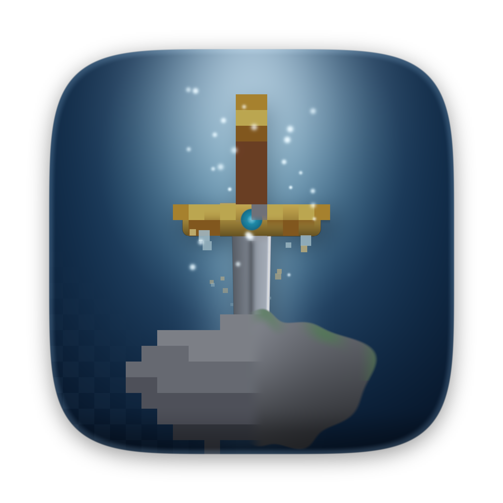

<p align="center">
  
</p>

<h1 align="center">The Legend of Zelda — Native macOS Recomp</h1>

<p align="center">
  A static recompilation of the 1986 NES classic into native code for macOS,<br>
  with a Metal renderer and a sound engine that remaster it in real time.
</p>

<p align="center">
  
  
  
  
</p>

> **No game data is included.** You need your own legally obtained ROM dump. The build recompiles
> *your* ROM locally; nothing derived from the game is ever committed to this repository.

---

## Highlights

- **A real recomp, not an emulator loop:** all of the game's 6502 code is translated to C ahead of time (~19,000 instructions in ~2,500 functions), including the routines the game copies into cartridge RAM. In every session tested so far, 100% of execution ran as native code.
- **Verified:** in automated lockstep tests the recompiled build matches a reference interpreter bit for bit, every frame (RAM, video and audio).
- **Remastered 2026 graphics:** relief lighting with sun and sky, soft shadows cast by trees, rocks and walls, character drop shadows, ambient occlusion, flickering firelight and Link's lantern in caves and dungeons, animated water, HDR bloom, filmic tonemapping, and EDR output on XDR displays.
- **Ultra 2026 tier:** global illumination, drifting cloud shadows, wind in the foliage, volumetric light, embers, fireflies, water reflections, depth of field and anamorphic lens flares.
- **Remastered 2026 sound:** the game's own music and sound data play live on modern synthesized instruments (Orchestral or Synthwave) with stereo, hall reverb and mastering. Original and Enhanced Chip modes are also available.
- **Configurable:** six presets and over 50 live settings. Every keyboard and controller input can be rebound. Hold **F1** at any time to see the original image.
- **Quality of life:** save states, automatic battery saves, fast forward, full screen, a performance overlay, and a choice of PAL 50 Hz or NTSC 60 Hz timing.

---

## Quick start

**Requirements:** macOS 13 or later, and Xcode or the Command Line Tools (`xcode-select --install`, which includes Swift and Python 3).

```bash
git clone https://github.com/lydianb79/The-Legend-of-Zelda.git
cd The-Legend-of-Zelda
./build.sh "/path/to/Legend of Zelda, The (Europe).nes"
open "build/Zelda Recomp.app"
```

If you don't pass a path, `build.sh` uses the first `.nes` file it finds inside the project folder or in the folder next to it.
The first build takes a minute or two, mostly compiling the generated C.

What `build.sh` does:

1. **Recompile:** `Tools/recompile.py` reads your ROM and writes `Sources/NESCore/generated/recomp_gen.c`.
2. **Build:** `swift build -c release` compiles the C runtime, the generated code and the Swift/Metal app.
3. **Package:** it assembles `build/Zelda Recomp.app` with its icon, signs it ad hoc, and records your ROM's path so the app opens it automatically.

**Tested ROM:** the European release (`Legend of Zelda, The (Europe).nes`, PRG CRC32 `ED7F5555`).
Other MMC1 revisions should also build. Any code the recompiler doesn't discover statically runs through the
built-in interpreter, and the next build turns it into native code (see [How the recomp works](#how-the-recomp-works)).

---

## Graphics

Open **Settings… (⌘,)**. Every change applies live while you play.

### Presets

| Key | Preset | Look |
|---|---|---|
| ⌘1 | **Original** | Untouched pixels and palette |
| ⌘2 | **Crisp HD** | Anti-aliased edges, light bloom, no relighting |
| ⌘3 | **Remastered 2026** (default) | Relief lighting, shadows, dynamic lights, water, bloom, grading |
| ⌘4 | **Ultra 2026** | Remastered, plus 6× resolution and the Ultra effects |
| ⌘5 | **Cinematic** | AgX filmic tone, deeper shadows, darker dungeons, stronger lens effects |
| ⌘6 | **Retro CRT** | Scanlines, aperture grille, curvature and phosphor bloom |

**F2** cycles through the presets. Hold **F1** to compare with the original at any time.

### Settings tabs

| Tab | Options |
|---|---|
| **Graphics** | Upscaler (Pixel Perfect / Smooth Edges AA / Soft), internal resolution 2×–8×, aspect ratio (8:7 TV pixels, square, integer, stretch), palette (Classic, Vivid, Soft Pastel), ambient fill for wide screens, HDR/EDR, V-Sync, stats overlay |
| **Lighting** | Sun direction, elevation and intensity, ambient light, relief depth, scenery height, sprite volume, ambient occlusion, animated water, cast shadows (strength, softness), flame and lantern lights, emissive glow, cave and dungeon darkness |
| **Ultra 2026** | Global illumination, volumetric light, 2× shadow samples, cloud shadows, wind in foliage, water reflections, particles, depth of field, anamorphic flares |
| **Post FX** | Bloom (intensity, threshold), tonemapper (Neutral, AgX, ACES, off), exposure, contrast, saturation, temperature, vignette, film grain, chromatic aberration, sharpening, CRT scanlines and curvature |

The HUD is never relit, so hearts, rupees and the map always stay crisp.

---

## Sound & music

Choose the engine in **Settings → Audio & System**. You can switch at any time, even mid-song.

| Engine | Description |
|---|---|
| **Original** | The console's 2A03 sound chip mix, untouched (mono) |
| **Enhanced Chip** | Band-limited chip voices, stereo placement, room reverb, bus compression |
| **Remastered 2026** (default) | Modern instruments driven live by the game's own music data, with hall reverb and mastering |

In **Remastered 2026**, the game's sound driver keeps running unchanged. On every audio sample, the live state of each
channel (pitch, volume, duty and note triggers) plays a synthesized instrument:

- **Orchestral:** a brass-like lead with a filter envelope and delayed vibrato, a stereo string ensemble, a warm bass with a sub octave, and percussion "bodies" under the noise channel.
- **Synthwave:** a supersaw lead, synth plucks, a resonant analog bass and punchy drums.

Sliders cover volume, reverb, stereo width, bass boost and how much of the original chip sound to blend in.
Everything is synthesized; no audio is sampled from the game.

---

## Controls

All bindings can be changed in **Settings → Controls**. Each NES button takes any number of keys and controller buttons.
MFi, Xbox, PlayStation and Switch Pro controllers work over Bluetooth or USB.

| NES | Keyboard | Controller |
|---|---|---|
| D-Pad | Arrow keys / WASD | D-pad / left stick (4-way) |
| A (sword) | X / K | A / Cross |
| B (item) | Z / J | X / Square |
| Start | Return | Menu / Options |
| Select | Right Shift / Tab | View / Share |
| Fast forward (hold) | ` | R2 / RT |

| Hotkey | Action |
|---|---|
| F1 (hold) | Show the original graphics |
| F2 | Cycle graphics presets |
| F3 | Performance stats overlay |
| F5 / F8 | Quick save / quick load |
| ⌥1 … ⌥9 | Choose save-state slot |
| ⌘1 … ⌘6 | Apply a preset |
| ⌘P / ⌘R / ⇧⌘R | Pause / reset / power cycle |
| ⌃⌘F, Esc | Enter / leave full screen |
| ⌘, | Settings |

The game's battery saves (your three save files) are written automatically. Save files and save states are stored in
`~/Library/Application Support/ZeldaRecomp/` (**Game → Open Save Folder**).

### Timing

The European ROM runs at PAL **50 Hz**, its original speed. **Settings → Audio & System → Game speed** can switch to
NTSC **60 Hz** timing, which matches 60/120 Hz displays exactly but runs the game about 20% faster.

---

## How the recomp works

```
your ROM ──► Tools/recompile.py ──► recomp_gen.c ──┐
                                                   ├─► swift build ──► Zelda Recomp.app
Sources/NESCore (C runtime) ───────────────────────┤
Sources/ZeldaRecomp (Swift + Metal) ───────────────┘
```

- **Discovering the code:** the recompiler walks the program from the reset, NMI and IRQ vectors. It tracks which PRG bank the MMC1 mapper has selected (by recognising the game's bank-switch helper) and follows the game's jump-table helper, whose inline address tables it reads. Address-only coverage seeds in `Tools/seeds/` fill the remaining gaps.
- **Translating it:** each 6502 instruction becomes C built from the same macros the reference interpreter uses (`Sources/NESCore/nes_internal.h`). Addressing modes are resolved at compile time, so zero-page, RAM and ROM accesses become direct array reads.
- **Entering blocks:** every block is a C function with an entry switch. Interrupts can therefore return into the middle of a block without falling back to the interpreter.
- **Timing:** cycles are counted exactly per instruction, including page-cross and branch penalties. The PPU (picture chip) and APU (sound chip) catch up lazily on register access and once per scanline, which keeps both vblank and sprite-0 timing exact.
- **Code in cartridge RAM:** at boot the game copies 4.7 KB of routines to `$6C90–$7EFF`. These are recompiled as a guarded *overlay*: if the RAM bytes ever stop matching the ROM copy, that block runs in the interpreter instead.
- **Self-improving coverage:** any ROM address the interpreter has to execute is logged to `~/Library/Application Support/ZeldaRecomp/coverage/` when you quit. The next `./build.sh` turns those addresses into native code.

Under **Settings → Audio & System**, you can switch the native code off to run the reference interpreter instead,
for comparison or debugging.

---

## Testing

The core is plain C, so it can be tested headlessly on Linux or macOS without the app.
The bot scripts need Python 3 with Pillow (`pip install pillow`).

```bash
export ZELDA_ROM="/path/to/your/zelda.nes"
python3 Tools/recompile.py --rom "$ZELDA_ROM" --out /tmp/gen/recomp_gen.c --coverage Tools/seeds
cc -O2 -shared -fPIC -ISources/NESCore -o /tmp/libnes_interp.so Sources/NESCore/*.c Sources/NESCore/generated/recomp_gen.c -lm
cc -O2 -shared -fPIC -ISources/NESCore -o /tmp/libnes_recomp.so Sources/NESCore/*.c /tmp/gen/recomp_gen.c -lm
mkdir -p out && python3 Tests/difftest.py /tmp/libnes_interp.so /tmp/libnes_recomp.so 6000 11
```

| Script | Purpose |
|---|---|
| `Tests/difftest.py`, `difftest2.py` | A bot plays the game (attract mode, file select, the sword cave, overworld combat). The interpreter and recompiled builds run in lockstep and are compared every frame |
| `Tests/coverage.py` | Plays in interpreter mode and writes the executed ROM addresses as new coverage seeds |
| `Tests/harness.c` | Headless runner that dumps frames, RAM traces and audio (`AUDIO_MODE=0/1/2`, `AUDIO_STYLE=0/1`) |

**Current result:** about 19,000 frames bit-identical between the two builds, with **0** instructions falling back to the interpreter.

---

## App icon

The default icon is **Sword in Stone**. Five more original variants are in `Resources/icons/`.
To build with a different one:

```bash
ICON=2_dungeon ./build.sh        # 1_emerald · 2_dungeon · 3_golden_hour · 4_sword_in_stone · 5_hearts · 6_retro_crt
```

The icons are rendered procedurally by `Tools/icon/icons.py`; edit it and re-run to make your own.

---

## Project layout

```
build.sh                    one-step build: recompile → swift build → .app
Package.swift               Swift package (NESCore C target + ZeldaRecomp app)
Tools/recompile.py          6502 → C static recompiler
Tools/seeds/                coverage seeds + RAM-overlay description (addresses only)
Tools/icon/                 procedural icon renderer
Sources/NESCore/            C runtime: interpreter, PPU, APU, MMC1, scheduler, save states,
                            audio ring buffer, remastered synthesizer (synth.c)
Sources/NESCore/generated/  placeholder; the real recomp_gen.c is generated locally (git-ignored)
Sources/ZeldaRecomp/        Swift app: Metal renderer + shaders, SwiftUI settings, input, audio
Resources/                  app icon (default + variants)
Tests/                      headless harness, Python bot, differential & coverage tests
```

---

## Troubleshooting

| Problem | Fix |
|---|---|
| `swift: command not found` | Install Xcode or run `xcode-select --install` |
| The app asks for a ROM on every launch | Pick it once; the path is remembered. Rebuilding also records it |
| "This ROM differs from the recompiled one" | The app was built from a different dump. Run `./build.sh` with this ROM; until then the interpreter is used |
| Judder on a 60/120 Hz display | Expected for 50 Hz PAL content; switch **Game speed** to NTSC 60 Hz |
| The Dock still shows an old icon | Quit the app, then unpin and re-pin it (macOS caches icons) |
| Old save states don't load | States from earlier builds are rejected after format changes; battery saves are unaffected |

---

## Legal

This repository contains **no ROM data, graphics, music or code from the game**.
`Sources/NESCore/generated/` holds only a placeholder; the real file is generated on your machine from your own dump and
is excluded by `.gitignore`, as are ROMs, saves and build output. The coverage seeds contain addresses only.

*The Legend of Zelda* is a trademark of Nintendo. This is an unofficial fan project, not affiliated with or endorsed by Nintendo.
The app icons are original artwork.
